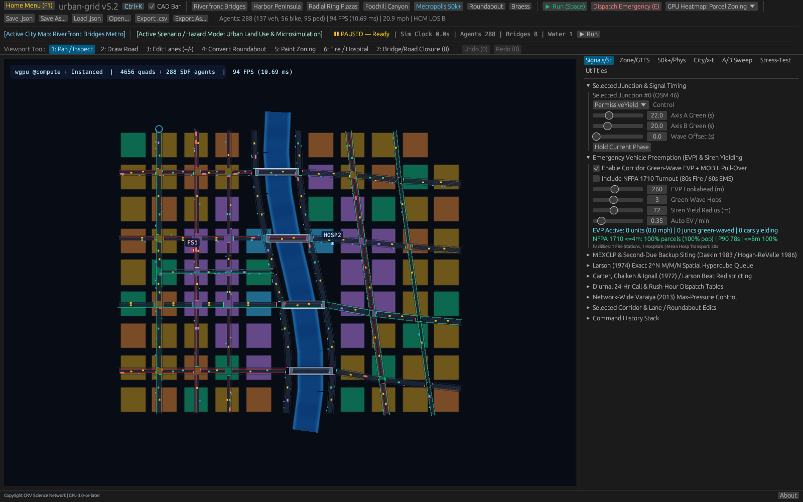

# `urban-grid` (`v5.2.0`) — Standalone Microscopic Traffic, GTFS Transit, 50k+ `wgpu` Crowd & Multi-Hazard Urban Resilience Workbench



**`urban-grid` (`v5.2.0`)** is a standalone, pure-Rust urban planning, fixed-route public transit, 50k+ agent microscopic traffic, and multi-lifeline hazard/resilience workbench. It compiles [OpenStreetMap](https://wiki.openstreetmap.org/wiki/Key:highway) (`.osm` XML, `.osm.pbf`, and Overpass API) and [GTFS Schedule](https://gtfs.org/documentation/schedule/reference/) feeds into 3.5 m metric lane geometry, coupling [Wilson (1967)](https://www.semanticscholar.org/paper/A-statistical-theory-of-spatial-distribution-models-Wilson/2f8308996a9bf467ad7548fcdd357504938c2ad6) IPF gravity distribution, [McFadden (1974)](https://escholarship.org/uc/item/61s3q2xr) logit mode split, [Treiber et al. (2000) `IDM`](https://link.aps.org/doi/10.1103/PhysRevE.62.1805) + [Kesting et al. (2007) `MOBIL`](https://akesting.de/download/MOBIL_TRR_2007.pdf) traffic, [Varaiya (2013)](https://www.semanticscholar.org/paper/The-Max-Pressure-Controller-for-Arbitrary-Networks-Varaiya/abafcf4d5f1231c05d385dd36ed7fca420da293f) Max-Pressure adaptive signal control, emergency vehicle preemption & [Daskin (1983) `MEXCLP`](https://pubsonline.informs.org/doi/10.1287/trsc.17.1.48) / [Larson (1974) hypercube](https://www.researchgate.net/publication/222270336_A_hypercube_queuing_model_for_facility_location_and_redistricting_in_urban_emergency_services) siting, coupled power/water/wastewater/burn-scar/WTP lifelines, and FEMA recovery logistics across a custom 3-pass `wgpu` `@compute` + instanced WGSL workbench, `Ratatui` terminal console, and `Clap` CLI.

## Workspace Architecture

- **`crates/ug-core`**: Pure-Rust deterministic simulation, active-graph 15-minute multimodal routing (`environment.rs`), multi-siren corridor preemption & `IDM`-bounded emergency yielding (`emergency.rs`, `traffic.rs`), OSM/GTFS compilation (`osm.rs`, `network.rs`, `transit_gtfs.rs`), zoning & interactive CAD/undo (`zoning.rs`, `network_edit.rs`, `history.rs`), facility siting/redistricting/diurnal profiles (`mclp.rs`, `hypercube.rs`, `diurnal.rs`, `resilience.rs`), coupled lifelines & multi-hazard resilience (`utilities.rs`, `seismic_mc.rs`, `ffe_conflagration.rs`, `hospital_surge.rs`, `aeromedical_medevac.rs`, `evacuation_contraflow.rs`, `emergency_shelters.rs`, `commodity_resupply.rs`, `transit_evacuation.rs`, `warning_mobilization.rs`, `fema_comms.rs`, `fema_isb_pods.rs`, `fema_usar_debris.rs`, `fema_gsb_drc_tdms.rs`, `wildfire_cameras.rs`, `burn_scar_debris_flow.rs`, `wtp_turbidity_storage.rs`), parallel A/B experiments (`batch_eval.rs`), JSON/CSV persistence (`persistence.rs`), and zero-allocation GPU packers (`gpu_pack.rs`).
- **`crates/ug-app`**: Unified binary (`urban-grid`) bundling the 5-domain `egui` + `wgpu` workbench (`gui.rs`, `wgpu_pass.rs`, `shaders/plume_compute.wgsl`, `shaders/urban_viewport.wgsl`), `Ratatui` terminal mode (`tui.rs`), and headless CLI (`main.rs`, `batch.rs`).

## Controls, Hotkeys & Viewport HUD

| Scope | Control / Hotkey | Behavior |
| :--- | :--- | :--- |
| Global | `F1` / `Home` | Toggle 5-domain Main Entrance Hub (`paused` at `t = 0.0 s`) |
| Global | `Ctrl + K` / `Escape` | Quick-Jump Command Palette / Dismiss active modal or palette |
| Simulation | `Space` | Play / Pause traffic & GPU `@compute` advection-diffusion (skips compute dispatch while paused) |
| Simulation | `[` / `]` | Halve / Double simulation speed (`0.25x .. 16.0x`) |
| Viewport | `R` / `0` / Left-Drag / Wheel | Fit camera to road network / Pan (or paint zones in Tool `5`) / Zoom (`0.18 .. 10.5 px/m`) |
| CAD Tools | `1` .. `7` | `Inspect`, `Draw Road`, `Edit Lanes`, `Convert Roundabout`, `Paint Zoning`, `Place Facility`, `Bridge/Road Closure` |
| Dispatch / Edit | `E` / `Ctrl + Z` / `Ctrl + Y` | Dispatch Emergency Responder / 64-step Undo & Redo |
| HUD & Buffers | Bottom-left / Bottom-right | Contextual units & swatches for all 22 active heatmap layers; dynamic metric scale bar + wind-rose arrow; lock-free double-buffered `gpu_recycle_pool` |

## Quick Start & CLI Subcommands

```bash
# Run full workspace unit & headless validation suite
cargo test --workspace

# Launch the interactive 120+ FPS egui + wgpu desktop workbench
cargo run --release

# Launch Terminal Studio (Ratatui)
cargo run --release -- tui --scenario riverfront-bridges --gtfs assets/metro_gtfs --max-pressure

# Run headless simulation & export JSON snapshot + 1 Hz CSV telemetry
cargo run --release -- simulate --scenario riverfront-bridges --tod-upzone --seconds 180 --save-snapshot exports/riverfront_tod.json --csv-out exports/riverfront_tod.csv

# Parallel Rayon Fixed-Time vs. Max-Pressure vs. Roundabout sweep
cargo run --release -- batch --scenario harbor-peninsula --gtfs assets/metro_gtfs --seconds 180 --demand-scales 0.75,1.0,1.35 --replicates 2 --csv-out exports/harbor_scorecard.csv
```

Core CLI subcommands: `gui`, `tui`, `simulate`, `compare`, `batch`, `mclp`, `stress-test`, `seismic-mc`, `hypercube`, `redistrict`, `diurnal`, `utilities`, `ffe`, `surge`, `medevac`, `evacuate`, `shelters`, `resupply`, `transit-evac`, `warning`, `fema-comms`, `fema-pods`, `fema-usar`, `fema-recovery`, `wildfire`, `debris-flow`, `wtp-turbidity`, `import` (key flags: `--scenario`, `--osm`, `--gtfs`, `--max-pressure`, `--tod-upzone`, `--seconds`, `--demand-scales`, `--replicates`, `--threads`, `--csv-out`, `--save-snapshot`).

## Scientific Accuracy & Validation Metrics

- **Workspace Verification**: `cargo test --workspace` (`60 passed; 0 failed`: `50` `ug-core` unit tests, `3` `headless_validation` benchmarks, `7` `ug-app` unit/GUI tests).
- **Active-Graph 15-Min Routing & Acoustic Noise (`environment.rs`)**: Routes parcel 15-minute accessibility strictly across open road/bridge links (`!seg.closed`), lowering `access_15min_pct` cleanly when all river bridges close; corridor `noise_dba` scales physically with open lane density, fleet heavy mix, and rolling speed `(v_kph / 35)^2.4`.
- **Multi-Siren Yielding & Plume/Shader Fidelity (`emergency.rs`, `traffic.rs`, `plume_compute.wgsl`, `urban_viewport.wgsl`)**: Stores multiple sirens per segment (`Vec<Vec<f64>>`), caps yielding braking per step (`<= idm.hard_decel_mps2`), scales 2D stencil diffusion by `dt / dx^2` (CFL-clamped), zeroes wind drift on `AgentDensity`, derives GPU iso-contours directly from float32 scalar fields, and decouples vehicle LOD `px_radius` from `halo_scale`.
- **Headless Benchmarks ([`validation/README.md`](validation/README.md))**: T1 fundamental diagram (`240 -> 2,100 veh/h/ln` on `32.56` lane-km, `0` collisions, min bumper headway `1.929 m`); T2 NFPA 1710 siting (`100.0%` 4-min parcel coverage under MCLP, `p90 = 33.9 s` under 4-station `MEXCLP`/hypercube); T3 Cascadia M9.0 seismic lifelines + contraflow evacuation.

## Documentation & Citation

- **User Guide & Scientific Methods**: [`docs/USER_GUIDE.md`](docs/USER_GUIDE.md), [`docs/SCIENTIFIC_METHODS.md`](docs/SCIENTIFIC_METHODS.md), [`docs/urban-grid-v5.2-user-guide.pdf`](docs/urban-grid-v5.2-user-guide.pdf)
- **CRV Science Apps Hub**: <https://crvscience.com/apps>
- **Companion Preprint (`APP-PREPRINT-11`)**: *Urban-Grid: Modeling City Traffic, Emergency Response Coverage, and Earthquake Evacuation* — <https://crvscience.com/apps/preprints/urban-grid-microscopic-traffic-resilience>
- **Concept DOI**: [`10.5281/zenodo.24222394`](https://doi.org/10.5281/zenodo.24222394)
- **Source Repository**: <https://github.com/bpwhite/crvscience-urban-grid>
- **License**: GNU General Public License v3.0 or later (`GPL-3.0-or-later`).
